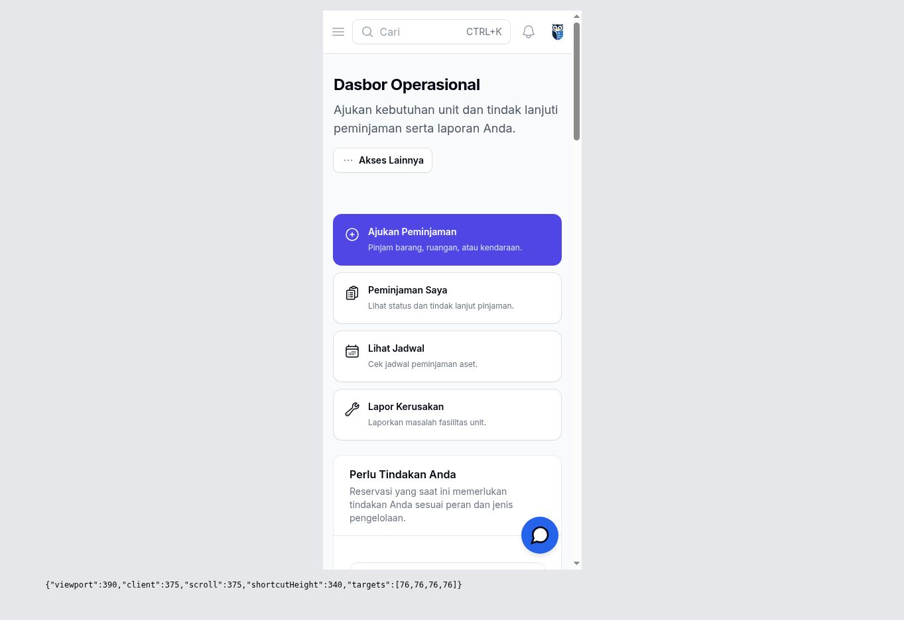
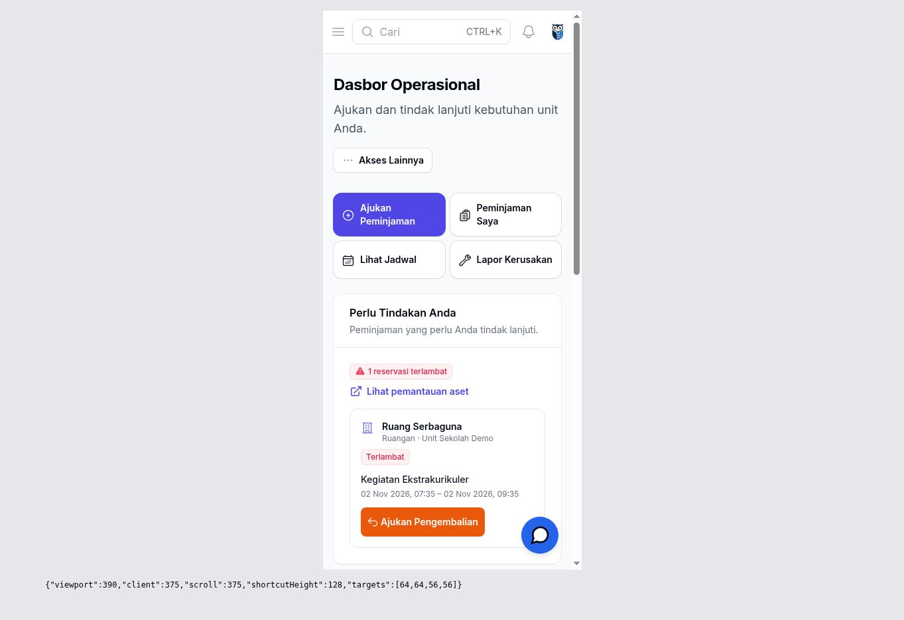
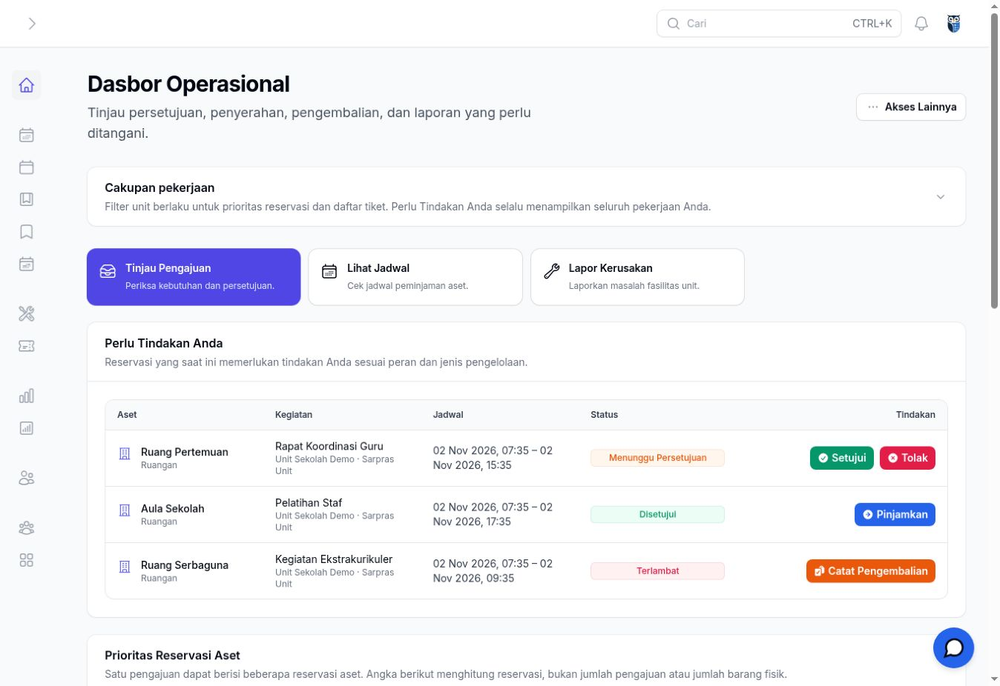
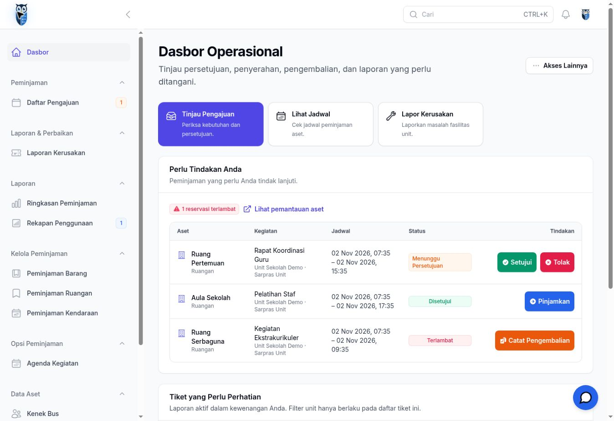
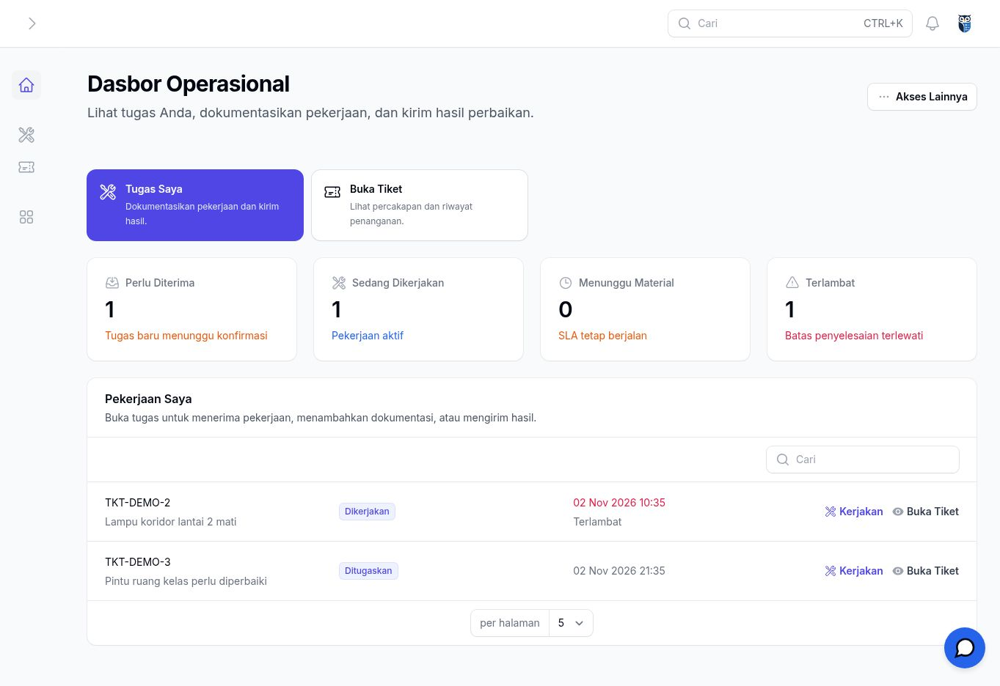
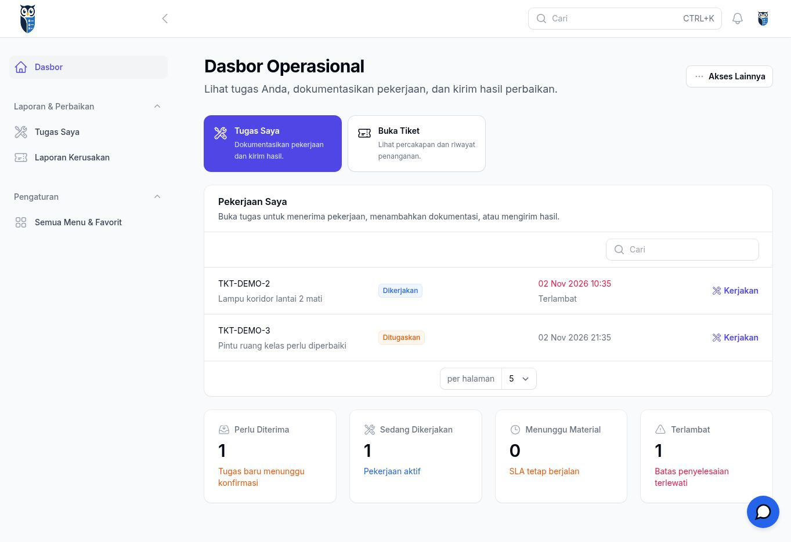

# Penyempurnaan UX PR #31

Review atas seluruh diff PR tahap pertama (60 file pada `1bf68f3`), dilanjutkan perbaikan pada branch `feat/role-based-dashboard-navigation`. Target tetap `main`; PR tidak di-merge.

## Hasil review dan perbaikan

| Masalah | Perilaku akhir |
| --- | --- |
| Kerjakan membuka daftar umum | Membuka route detail tiket dengan record yang dipilih. Visibilitas memakai `TicketResource::canView`, `TugasTeknisi::canAccess`, dan pemeriksaan existing `mayAccept`/`mayWork`. Ownership, kualifikasi, persetujuan, penerimaan, dan status tetap diperiksa. Satu tautan tindak lanjut per baris menghindari duplikasi Kerjakan/Buka Tiket. |
| Empat pintasan mobile terlalu tinggi | Dua kolom dengan label yang tetap utuh; deskripsi pendukung tampil mulai `sm`. Target sentuh 56–64 px. Subjudul Sarpras dipadatkan. |
| Daftar dashboard berulang | Dashboard mengutamakan Perlu Tindakan Anda dan tiket aktif. Jumlah reservasi terlambat, penerimaan aset yang dapat dikonfirmasi, dan tautan pemantauan tetap terlihat. Prioritas Reservasi Aset lengkap dipindahkan ke Ringkasan Peminjaman. |
| Teknisi muncul karena akses administratif | Pintasan, header tindakan, dan statistik teknisi mensyaratkan tugas aktif milik sendiri dalam query visibility tiket. Menu teknisi bagi admin/pengelola tanpa tugas disembunyikan; route dan akses langsung ke riwayat tetap berlaku. Antrean tiket ditempatkan sebelum statistik teknisi. |
| Istilah navigasi internal | Kegiatan menjadi **Daftar Pengajuan** pada navigasi; Kegiatan Master menjadi **Agenda Kegiatan** dalam **Opsi Peminjaman** bersama Pengajuan Multi-aset. Daftar per jenis aset menjadi **Peminjaman Barang/Ruangan/Kendaraan** dalam **Kelola Peminjaman**. Kedua grup sekunder dapat diciutkan dan tertutup secara default. |
| Badge/tombol terpotong | Status dan label tombol membungkus teks. Judul kegiatan panjang tetap tampil lengkap. Kartu digunakan sampai sebelum breakpoint `xl`; tabel tampil pada desktop lebar. Tombol tindakan memiliki tinggi minimal 44 px. |
| Filter global tidak konsisten | Dashboard tidak lagi mempunyai filter unit global. Filter native Filament **Unit pelapor** hanya berada pada daftar tiket dan hanya tersedia bagi Fasilitas/Administrator. Query tetap memakai batas visibility resource dan mengabaikan manipulasi unit oleh non-Fasilitas. |
| Cakupan filter ringkasan tidak jelas | Keterangan pada form dan widget menjelaskan bahwa tanggal/status memfilter riwayat, sementara hanya unit memfilter pemantauan reservasi aktif. Pekerjaan terlambat tidak disembunyikan oleh tanggal/status historis. |

Angka Ringkasan Pengajuan tetap menghitung kegiatan; angka Prioritas Reservasi Aset dan pengingat dashboard menghitung reservasi. Tidak ada perubahan makna status atau transisi transaksi. Persetujuan, penyerahan, penerimaan dua pihak, pengembalian, keterlambatan, dan tiket aktif tetap tersedia.

## Relevansi peran

| Peran | Isi utama dan batas akses |
| --- | --- |
| Sarpras Unit | Ajukan, Peminjaman Saya, jadwal, laporan, tindakan peminjaman dan tiket sesuai visibility existing. |
| Admin Fasilitas | Tinjau pengajuan, antrean persetujuan/penyerahan/pengembalian, pengingat terlambat, tiket dengan filter lokal. |
| Teknisi | Tiket milik sendiri terlebih dahulu; Kerjakan hanya pada pekerjaan yang boleh diterima/dikerjakan. Statistik dan pintasan muncul bila ada tugas aktif. Menu tugas tetap menyediakan akses riwayat bagi anggota teknis. |
| Administrator | Operasional Fasilitas dan akses pengguna/pengaturan tetap tersedia; akses administratif saja tidak memunculkan tindakan teknisi. |
| Pengelola Aset | Peminjaman dan tiket dalam kewenangan pengelolaan existing; tidak mendapat akses pengajuan baru. |
| Multi-peran | Kapabilitas peminjaman dan tugas teknisi digabung bila ada pekerjaan aktif yang relevan; tidak memakai satu peran eksklusif. |

## Validasi

- `php artisan test --compact`: **225 passed, 1 skipped, 1741 assertions**. Tes yang dilewati membutuhkan MySQL; job CI `mysql-migration-smoke` menjalankan pengujian terkait pada MySQL.
- Tes baru/perbaruan mencakup URL Kerjakan untuk beberapa tiket, status tidak relevan, belum disetujui/belum diterima, tugas petugas lain, keanggotaan tidak aktif, hak lihat detail, admin/pengelola tanpa tugas, multi-peran, isolasi filter unit, serta penerimaan aset dua pihak yang tetap tampil pada dashboard.
- Suite lengkap mencakup peminjaman barang/ruangan/kendaraan, kegiatan master, approval, QR, serah-terima dua pihak, pengembalian, tiket/maintenance, bukti, dan batas akses unit. Transaksi diuji melalui Laravel/Livewire; ini tidak menggantikan UAT browser staging.
- `npm ci --no-audit`, `npm run build`: lulus; Vite 6.4.5, 65 modul terbangun.
- `npm audit --audit-level=high`: **0 vulnerabilities** setelah patch. Audit Composer produksi (`--locked --no-dev --abandoned=ignore`): **0 advisory**.
- `composer validate --no-check-publish`: valid, dengan peringatan constraint exact `endroid/qr-code` yang sudah ada.
- Lint seluruh PHP `app`, `database`, `tests`, `php artisan invman:security-audit`, dan `git diff --check`: lulus.
- Perbandingan method, URI, nama, dan action route: **181 route main dipertahankan**, **183 route sebelum/sesudah review PR tetap sama**; tidak ada route yang hilang atau berubah.
- Klik Kerjakan pada preview membuka `TKT-DEMO-2` secara langsung, bukan daftar umum; tindakan Menunggu Material dan Catat Hasil tersedia pada detailnya.

Patch dependensi terpisah dan terbatas pada lockfile: `follow-redirects` 1.16.1 → 1.16.2 ([advisory](https://github.com/advisories/GHSA-mrwp-f3q8-3g9p)) dan Vite 6.4.4 → 6.4.5 ([advisory maintainer](https://github.com/vitejs/vite/security/advisories/GHSA-8g5g-mxqh-grgj)). Patch `symfony/mime` dari tahap pertama tetap dipertahankan. Tidak ada upgrade major atau perubahan workflow audit.

## Visual QA

Screenshot menggunakan aplikasi Laravel/Filament yang dirender browser dengan data sintetis pada harness preview lokal. Mobile diuji dalam iframe dengan viewport tepat 360/390/430 × 844; desktop berukuran 1365 × 936. Scrollbar vertikal browser mengurangi lebar konten 15 px. Pengukuran di bawah berasal dari DOM aplikasi pada harness sementara, bukan perkiraan gambar.

| Sarpras | Lebar konten / scrollWidth | Tinggi area pintasan | Tinggi target pintasan |
| --- | --- | --- | --- |
| Sebelum, 390 px | 375 / 375 px | 340 px | 76 px |
| Sesudah, 360 px | 345 / 345 px | 136 px | 64 px |
| Sesudah, 390 px | 375 / 375 px | 128 px | 56–64 px |
| Sesudah, 430 px | 415 / 415 px | 120 px | 56 px |

Pada 390 px area pintasan berkurang sekitar **62%**. Pekerjaan terlambat dan tombol pengembaliannya terlihat pada layar awal di ketiga viewport fixture. Tidak ada horizontal overflow. Kartu Fasilitas 360 px juga memiliki lebar konten/scrollWidth 345/345 px. Pada desktop dengan sidebar terbuka, lebar konten/scrollWidth 1348/1348 px dan tombol tindakan terukur 44 px tanpa overflow internal. Judul kegiatan panjang sengaja ditambahkan sebagai fixture tambahan untuk memeriksa pembungkusan teks.

| Bagian | Sebelum review | Sesudah review |
| --- | --- | --- |
| Sarpras 390 px |  |  |
| Fasilitas desktop |  |  |
| Teknisi desktop |  |  |

Bukti tambahan:

- [Sarpras 360 px](ui-redesign/pr31-review/after-sarpras-360.jpg) dan [430 px](ui-redesign/pr31-review/after-sarpras-430.jpg).
- [Tiket spesifik setelah klik Kerjakan](ui-redesign/pr31-review/after-ticket-detail.jpg).
- [Judul kegiatan panjang pada desktop](ui-redesign/pr31-review/after-long-title-desktop.jpg) dan [kartu approval mobile 360 px](ui-redesign/pr31-review/after-fasilitas-mobile-360.jpg).
- [Penjelasan filter dan pemantauan pada Ringkasan Peminjaman](ui-redesign/pr31-review/after-summary-filter.jpg).

## Risiko dan pekerjaan yang ditunda

- HTTP 419 saat polling Livewire kembali teramati pada **head PR sebelum perubahan** dan sesi fixture sesudahnya. Belum disimpulkan sebagai regresi produk. URL/akses staging tidak tersedia dalam konteks kerja ini, sehingga login normal dan transaksi browser staging belum dapat diverifikasi. UAT staging tetap menjadi syarat review sebelum merge; CSRF/session/security produksi tidak dilonggarkan.
- Harness fixture, runtime PHP, lisensi pengujian, database sintetis, instrumentasi ukuran viewport, dan sesi login fixture tidak masuk repository atau PR.
- Daftar ringkas penerimaan mengikuti batas snapshot existing (hingga 12 reservasi); jumlah keseluruhan dan akses ke pemantauan serta daftar peminjaman tetap tersedia.
- Preferensi buka/tutup navigasi existing tetap dihormati Filament. Akses URL lama, riwayat, dan pengelolaan administratif dipertahankan.
- Standardisasi seluruh halaman detail/form di luar dashboard, termasuk label status mentah yang masih ada pada detail tiket existing, ditunda agar perbaikan ini tetap kecil dan aman.
- Tidak ada perubahan schema, model, policy, role/permission, service transaksi, SLA, penugasan, QR, atau mekanisme kegiatan master. PR tetap terbuka untuk review akhir; tidak ada auto-merge.
