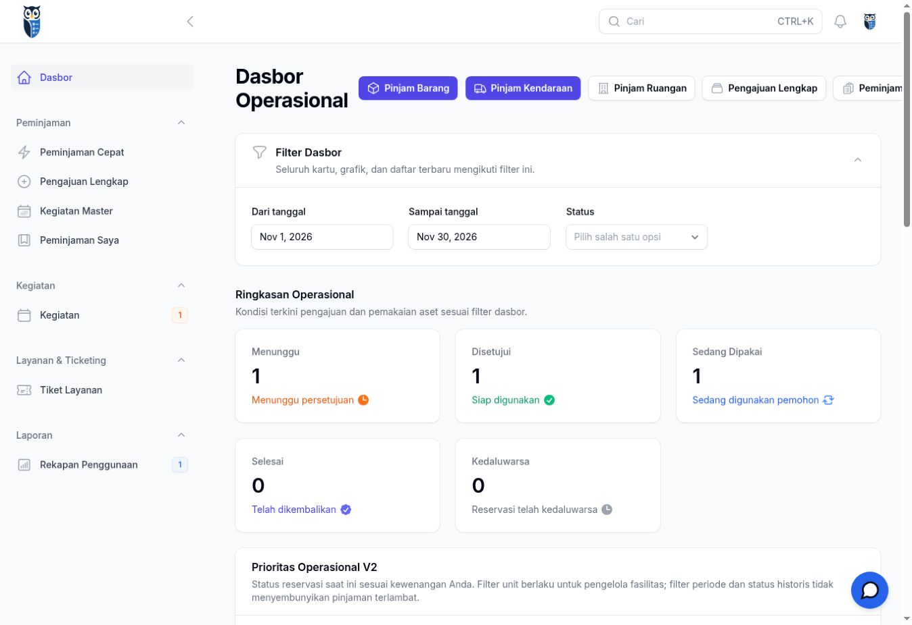
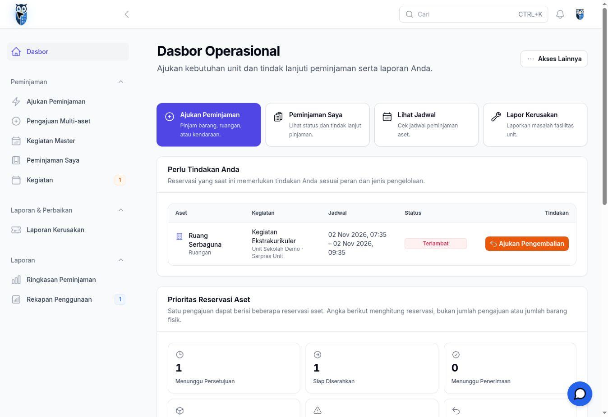
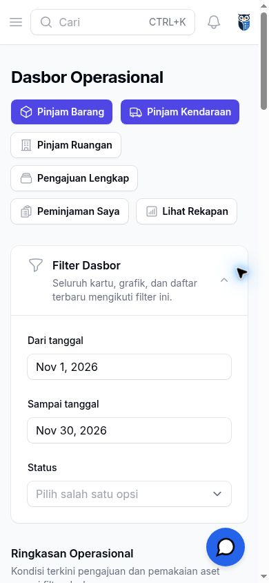
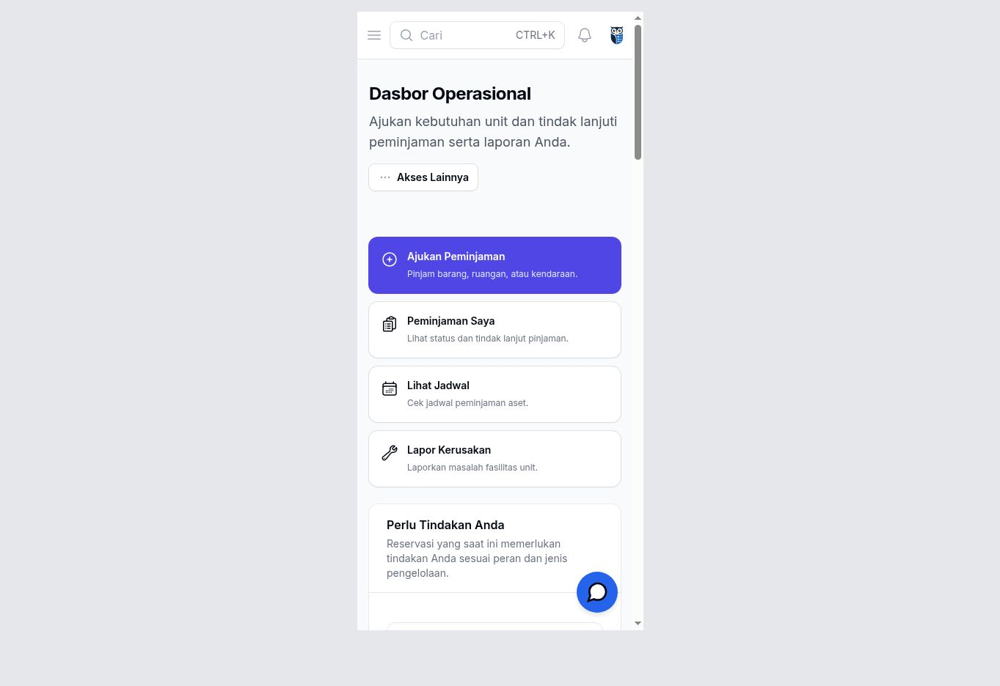
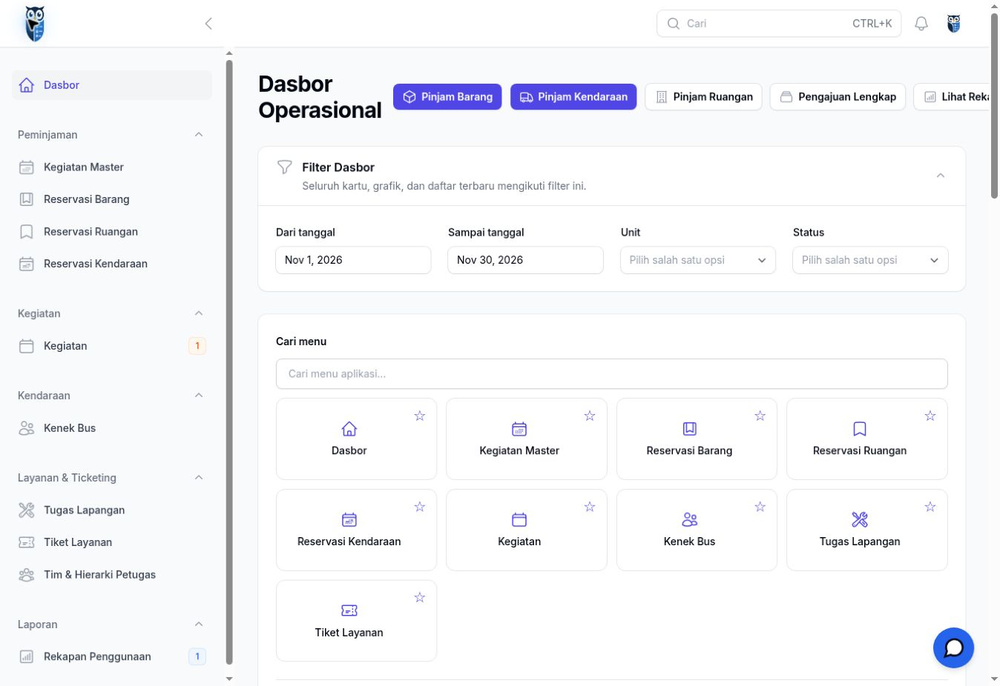
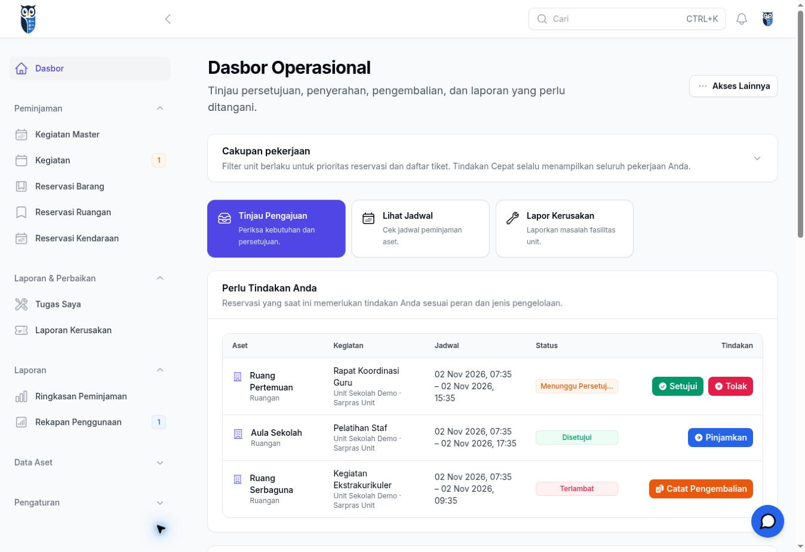
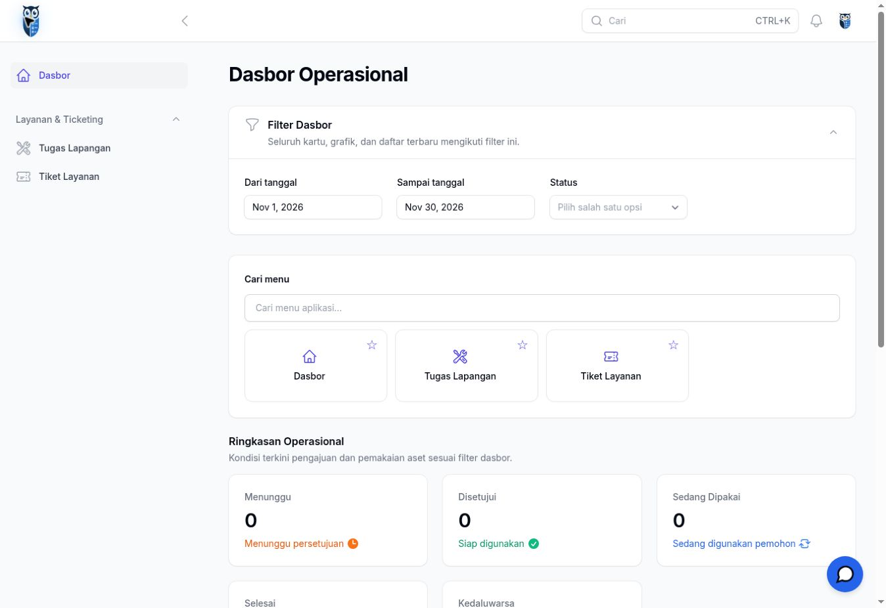
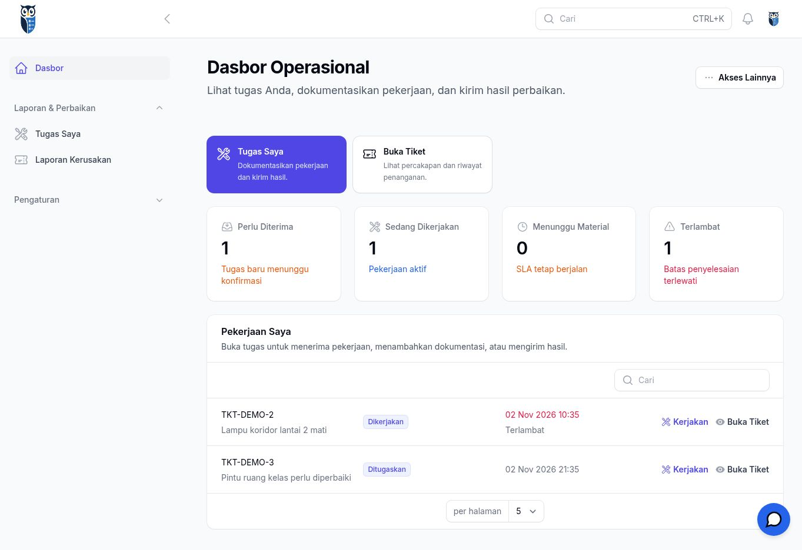
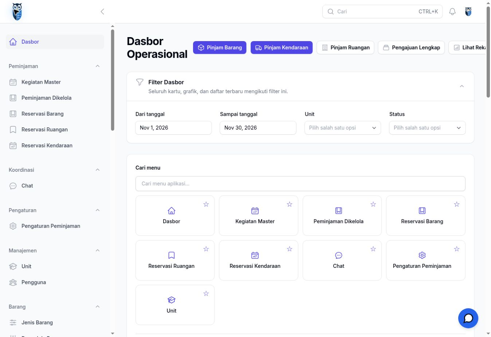
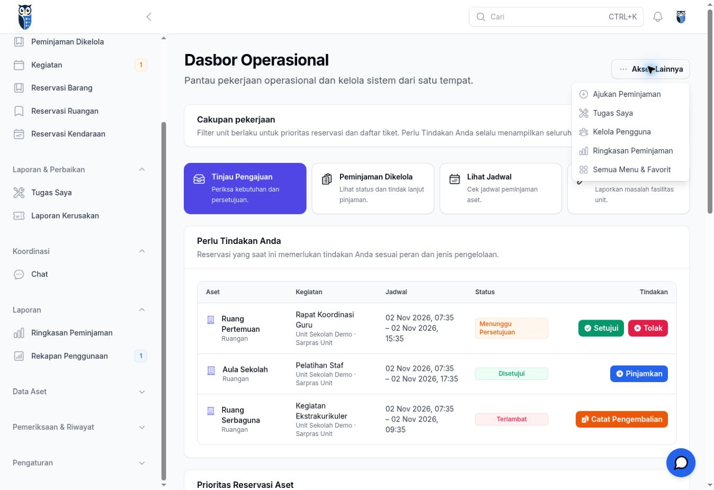

# Redesign UI/UX InvMan — tahap 1

Dasbor sekarang mendahulukan pekerjaan pengguna: pintasan harian, antrean tindakan, prioritas reservasi, dan laporan aktif. Fondasi tetap Laravel 12 / Filament 3. Tahap ini tidak mengubah migrasi, model, service transaksi, policy, role, permission, ataupun URL lama.

## Audit dan validasi rancangan

Baseline: `main` pada commit `153fef1`. Bukti browser menggunakan aplikasi Laravel yang dirender dari source baseline dan source redesign, dependensi lockfile yang sama, dan data sintetis yang sama. Tidak menggunakan data produksi.

| Langkah | Temuan baseline | Hasil tahap 1 | Kesehatan / batas pemeriksaan |
| --- | --- | --- | --- |
| 1. Sarpras membuka dasbor | Enam tindakan di header, terpotong pada desktop; filter dan statistik mendahului pekerjaan | Empat pintasan harian dan antrean yang dapat ditindak | Tampilan desktop dan viewport 390 × 844 diperiksa |
| 2. Fasilitas meninjau pekerjaan | Katalog menu dan statistik mendorong persetujuan ke bawah halaman | Tinjau Pengajuan, antrean persetujuan/penyerahan/pengembalian, prioritas keterlambatan dan tiket aktif | Tampilan desktop diperiksa; service tindakan existing dipertahankan |
| 3. Teknisi membuka dasbor | Kartu peminjaman kosong dan katalog menu; tugas tidak tampak | Tugas Saya, status tugas yang dapat dibuka, pekerjaan aktif, serta akses dokumentasi/penyelesaian melalui halaman tugas existing | Tampilan desktop diperiksa; query tugas dibatasi PIC sendiri |
| 4. Administrator membuka dasbor | Master data dan navigasi sistem mendominasi | Ringkasan prioritas operasional, pekerjaan, dan akses sistem lewat Akses Lainnya / Pengaturan | Tampilan desktop dan menu sistem diperiksa |
| 5. Pengguna mengajukan pinjaman | Beberapa tombol per jenis aset dan pengajuan lengkap sama menonjolnya | Ajukan Peminjaman menuju form sederhana; opsi lanjutan multi-aset tetap tersedia | Pintasan form diperiksa di browser; regresi barang, ruangan, kendaraan lulus |
| 6. Pengguna mencari ringkasan / menu favorit | Seluruh komponen ditempatkan di dasbor utama | Grafik, angka pengajuan, daftar terbaru dan kalender di Ringkasan Peminjaman; pencarian/pin menu di Semua Menu & Favorit | Akses halaman dan query regresi diuji; bukan penghapusan fungsi |

Susunan tersebut mengikuti brief yang disepakati: operasional terlebih dahulu, statistik sekunder, native Filament, serta hak akses existing sebagai batas. Tidak dibuat konsep visual atau alur bisnis baru. Peran pengelola aset dan akun dengan kombinasi Sarpras + teknisi juga diuji agar kedua pekerjaan tetap tersedia.

## Perubahan dan akses

| Bagian | Implementasi |
| --- | --- |
| Dasbor | Widget dipilih menurut kapabilitas peran existing; teknisi tidak mendapat statistik peminjaman |
| Pekerjaan harian | Kartu tautan responsif; hanya menampilkan tujuan yang diizinkan oleh page/resource existing |
| Antrean tindakan | Approval, penyerahan, dan pengembalian memakai action/service existing; kolom dapat membungkus sehingga tombol tidak terpotong |
| Tiket aktif | Widget baca-saja menggunakan `TicketResource::getEloquentQuery()`; teknisi murni melihat tugas PIC sendiri; tindakan kerja tetap di halaman tugas existing |
| Navigasi | Peminjaman, Laporan & Perbaikan, Koordinasi, Laporan; Data Aset, Pemeriksaan & Riwayat, Pengaturan diciutkan secara bawaan |
| Form sederhana | URL `/admin/peminjaman-cepat` tetap; label navigasi Ajukan Peminjaman; tautan Opsi lanjutan: multi-aset ke URL lama |
| Ringkasan | `/admin/ringkasan-peminjaman`, hanya kapabilitas peminjaman existing; kalender tidak mengikuti filter periode ringkasan dan dijelaskan secara eksplisit |
| Menu favorit | `/admin/semua-menu`, mempertahankan widget dan data pin existing, dengan batas peran yang sama dengan widget sebelumnya |

Angka **Ringkasan Pengajuan** menghitung kegiatan/pengajuan. Angka **Prioritas Reservasi Aset** menghitung baris reservasi, bukan jumlah pengajuan atau jumlah fisik barang. Satu pengajuan dengan dua reservasi diuji menghasilkan angka 1 dan 2. Kategori prioritas dapat beririsan.

Filter unit pada dasbor berlaku pada prioritas reservasi dan tiket. Antrean **Perlu Tindakan Anda** tetap menampilkan semua pekerjaan dalam kewenangan pengguna, sebagaimana perilaku existing; keterlambatan tidak disembunyikan filter historis. Preferensi buka/tutup grup sidebar yang sudah tersimpan di browser tetap dihormati oleh Filament.

## Validasi

- PHP 8.3, dependensi dipasang dari `composer.lock`; tidak ada pembaruan dependensi.
- `php artisan test --no-ansi`: **220 lulus**, **1 dilewati**, 1666 assertions. Tes dilewati khusus pembatasan foreign key MySQL; lokal menggunakan SQLite.
- Cakupan mencakup peminjaman barang/ruangan/kendaraan, master kegiatan, persetujuan, QR, serah-terima dua pihak, pengembalian, bukti, tiket/maintenance, visibilitas unit/pengelola, dan batas peran.
- `npm ci` dan `npm run build`: lulus.
- `composer validate --no-check-publish`, lint PHP, dan `git diff --check`: lulus.
- Perbandingan daftar route baseline dan branch: tidak ada method/URI/nama route lama yang dihapus atau berubah; dua halaman baru ditambahkan.
- Screenshot desktop empat peran serta Sarpras mobile tersedia di bawah. Mobile memakai iframe viewport 390 × 844 dalam browser cloud, bukan pengujian perangkat fisik.

**Batas browser QA:** sesi fixture preview sementara mengalami 419 pada polling Livewire, baik baseline maupun branch. Render, navigasi tautan, dan buka/tutup navigasi diperiksa; pengujian transaksi Livewire di browser secara menyeluruh belum dinyatakan lulus. Regresi tindakan diuji lewat PHPUnit/Livewire. Perlu UAT di staging melalui login normal sebelum merge. Harness fixture, sesi/lisensi pengujian, SQLite, runtime PHP, dan server preview tidak termasuk PR.

## Screenshot sebelum dan sesudah

### Sarpras — desktop

| Sebelum | Sesudah |
| --- | --- |
|  |  |

### Sarpras — mobile

| Sebelum | Sesudah |
| --- | --- |
|  |  |

### Fasilitas — desktop

| Sebelum | Sesudah |
| --- | --- |
|  |  |

### Teknisi — desktop

| Sebelum | Sesudah |
| --- | --- |
|  |  |

### Administrator — desktop

| Sebelum | Sesudah |
| --- | --- |
|  |  |

## Risiko dan tindak lanjut

1. Pengguna lama perlu mengenali pemindahan grafik/kalender/menu favorit. Semua fungsi tersebut tetap dapat dibuka dari navigasi dan Akses Lainnya sesuai izin.
2. Widget tiket memakai batas visibilitas existing; daftar menampilkan tiket aktif, bukan penetapan prioritas atau aturan SLA baru. Penugasan/penutupan tetap melalui halaman existing.
3. Review pengguna operasional dan UAT staging desktop/mobile diperlukan, terutama persetujuan, serah-terima QR, pengembalian, dokumentasi teknisi, dan sesi/polling.
4. Standardisasi seluruh tabel/form/empty state di luar dasbor dan penyederhanaan lebih jauh form multi-aset menjadi tahap berikutnya, dalam PR kecil terpisah. Jangan mengubah aturan kegiatan master atau otorisasi untuk memaksakan desain.
5. Tidak ada kebutuhan migrasi database. Deploy tetap membangun frontend dan membersihkan cache view mengikuti prosedur aplikasi existing.

PR tidak boleh digabung sebelum CI lulus dan hasil ditinjau.
